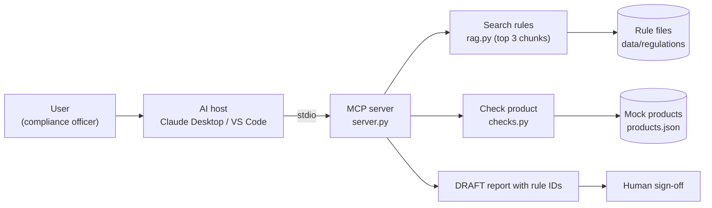

# Complir Compliance MCP Server

An MCP server that helps a retailer's compliance team check whether a physical product can be sold in a given market. It searches rule documents, checks a product against a market's rules, and returns a cited, draft list of gaps for a human to review.

> **All rules and products in this repo are mock data written for a project. They are not real law and must not be used for real compliance decisions.**


## 1. The problem this server solves

Before a product launches in a new country, someone has to answer one question: **"Can we sell this product in this market, and what is missing?"** Today that means searching long regulation documents and comparing them by hand with the product's label, claims and certificates. It is slow, and a missed rule can mean a blocked shipment or a recall.

This server gives an AI assistant a safe way to answer that question:
- it finds only the relevant rule sections instead of loading whole documents,
- it checks a product's data against a market's rules,
- it lists each gap together with the rule ID it breaks, so every finding can be verified,
- it marks the result as a **draft**, so a compliance officer still makes the decision.

**Who it is for:** the compliance team of a retailer that uses Complir. Complir's own team could also use it for demos and support.

### 2.1 The gap i identified

There are three gaps between what a compliance team has and what it needs:

1. **AI vs company knowledge.** A general AI assistant (Claude, Copilot) knows nothing about a company's own rule documents or product data. Without a connection it can only guess from general training, which is risky in compliance.
2. **Long documents vs a narrow question.** Rules live in long documents, but the question is small ("What label fields does the EU require?"). Loading whole documents into the AI wastes tokens and buries the answer.
3. **Product data vs rules.** A product's label, claims and certificates sit in one place and the rules in another. Someone has to compare them by hand and find what is missing.

### 2.2 How MCP server helps

| Gap | What the server does | Result |
|---|---|---|
| AI vs company knowledge | MCP connects the AI to the rule files and product data through tools, so it reads the real text instead of guessing | Answers quote the actual rule, e.g. EU-LAB-1 |
| Long documents vs a narrow question | `search_regulations` returns only the top 3 matching rule sections (RAG) | About 175 tokens instead of 1683, roughly 89-90% less |
| Product data vs rules | `check_product_against_market` and `compliance_gap_report` compare the two and list each gap with the rule it breaks | A cited to-do list instead of a manual comparison |

The server never approves anything. Reports are marked DRAFT / NOT APPROVED, so a compliance officer still reviews and signs off.

## 3. Tools, resources and prompts

| Type | Name | What it does | Why it is this type |
|---|---|---|---|
| Tool | `search_regulations(question, market)` | Searches the rule documents and returns only the top 3 relevant rule sections (RAG inside the tool). | The AI decides when it needs a rule, and the result depends on the question. |
| Tool | `list_products()` | Lists the catalogue with id, name, category and target markets. | Lets the AI find a product id from a product name. |
| Tool | `check_product_against_market(product_id, market)` | Runs the automated checks and returns gaps with rule IDs. | An action with inputs, so it is a tool. |
| Tool | `compliance_gap_report(product_id)` | Runs the checks for every target market and returns a report marked DRAFT / NOT APPROVED. | Needs a human sign-off before any decision is made. |
| Resource | `complir://coverage` | Lists the markets and rule documents covered, with rule counts. | Fixed reference information the user can attach to a chat. |
| Prompt | `pre_launch_review(product_id)` | A 4-step review script: get the report, quote each rule, summarise, state that it is a draft. | A reusable instruction the user picks, so weaker models follow the right steps. |

Tool names are plain verbs, and each description says when to use the tool and what each argument means, so a less capable model can choose correctly.

**Checks in `checks.py`:** required label fields, prohibited medical claims, unsubstantiated claims (no test report on file), CE / BIS / UL safety marks, and the small-parts warning for toys. These are simple field and keyword checks, which is enough for mock data. A real system would need much better language understanding.

## Tech stack

| Technology | Use in this project |
|---|---|
| Python 3.14 | Implements the MCP tools, the rules engine (`checks.py`) and the search code (`rag.py`). |
| MCP Python SDK (`mcp[cli]` 1.x, `FastMCP`) | Exposes the 4 tools, 1 resource and 1 prompt to MCP hosts over stdio. Pinned to 1.x because `FastMCP` was renamed in 2.x. |
| `rank_bm25` (BM25) | Ranks rule chunks by keyword match, so `search_regulations` can return only the top 3 relevant rules. |
| `tiktoken` | Counts tokens in `scripts/measure_tokens.py` for the full dump vs. 3 chunks comparison. |
| Markdown (`.md`) | Stores the mock rule documents, one file per market and topic. Each `##` section is one chunk. |
| JSON | Stores the 4 mock products in `data/products.json` (claims, certifications, label fields). |
| `uv` | Creates the `.venv`, installs packages from `pyproject.toml` and `uv.lock`, and runs the server (`uv run python server.py`). |
| Claude Desktop and VS Code Copilot | The two MCP hosts used for testing and the host comparison. |
| Git and GitHub | Version control and the repo that is submitted. |


### Why uv and not pip

This project uses **uv** to manage Python packages. uv is a fast package and project manager that replaces `pip` plus `venv`. One command, `uv sync`, creates the virtual environment and installs the exact package versions recorded in `uv.lock`, so the project runs the same way on every machine. `uv run` then starts any script inside that environment without activating anything by hand. I chose uv because it matches the class learning-log server, keeps versions locked (important here, since `mcp` 2.x broke `FastMCP`), and makes the Claude Desktop config simple: the host just runs `uv --directory <project> run server.py`. Plain `pip` would also work, but you would have to create and activate a virtual environment and keep a `requirements.txt` in sync yourself.

**Project structure:**

```
complir-mcp/
├── server.py              MCP server: 4 tools, 1 resource, 1 prompt
├── rag.py                 splits rule files into chunks, BM25 search (top 3)
├── checks.py              rules engine: label fields, claims, safety marks, small parts
├── test_search.py         quick test of the search for each market
├── data/
│   ├── products.json      4 mock products (P001 to P004)
│   └── regulations/       mock rules, one file per market and topic
│       ├── eu_labelling.md
│       ├── eu_safety.md
│       ├── india_labelling.md
│       ├── india_safety.md
│       ├── us_labelling.md
│       └── us_safety.md
├── scripts/
│   └── measure_tokens.py  token counts: full dump vs. 3 chunks
├── screenshots/           evidence for the host comparison
├── .vscode/mcp.json       VS Code Copilot server config
├── pyproject.toml         project and package list
├── uv.lock                exact package versions
└── README.md
```
### System design



## License
MIT License. See the `LICENSE` file. All rules and products in this repo are mock data for a student project and are not real law.
